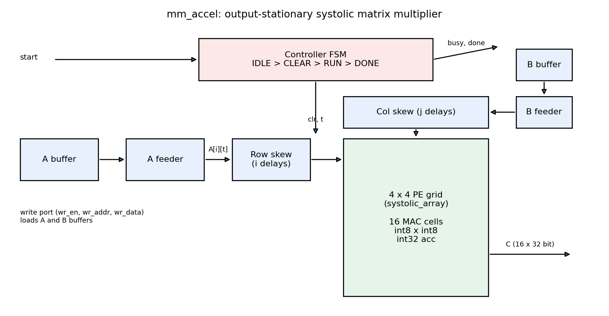
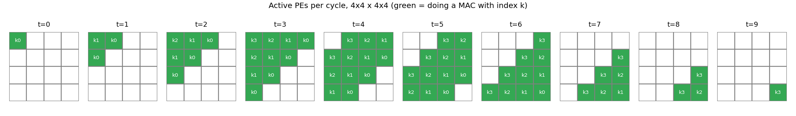
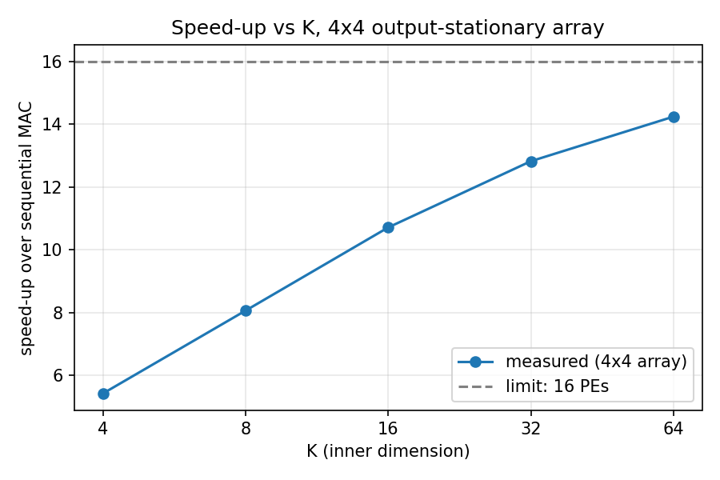
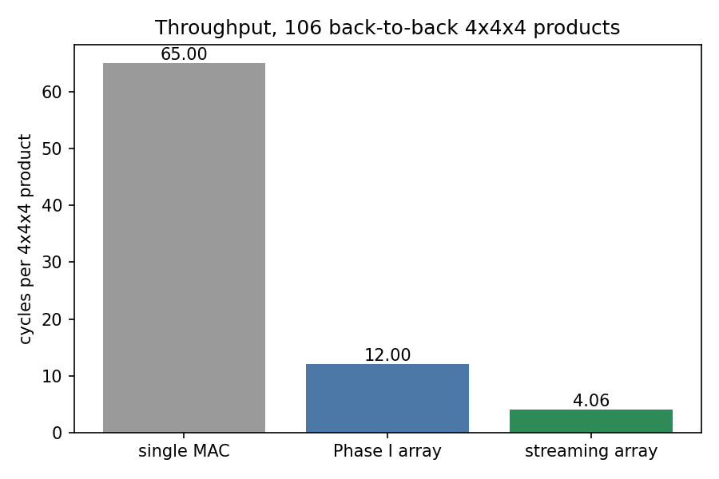
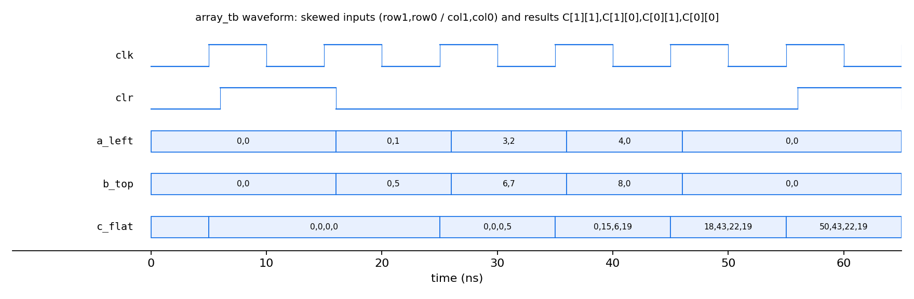

<div align="center">

# TPU-inspired systolic array accelerator

**A 4x4 grid of int8 multiply-accumulate units in Verilog that streams matrices back to back, tiles large products and runs a digit classifier, checked bit for bit against NumPy**

[](https://github.com/Vetri-78640/TPU-Inspired-Systolic-Array-Accelerator/actions/workflows/tests.yml)


Modern Computer Architecture - Project 12 - Team PowerPuffBoys, Section A - Phase II

[Report (PDF)](report/main.pdf) - [Phase I submission video](https://drive.google.com/file/d/1JgA02tjA79NwcuHHsivpMeJCt5c-VWQq/view?usp=sharing)

[Overview](#overview) - [Architecture](#architecture) - [Results](#results) - [Neural network demo](#neural-network-demo) - [Verification](#verification) - [Quick start](#quick-start) - [Structure](#repository-structure) - [Team](#team)

</div>

---

## Overview

A single multiply-accumulate (MAC) unit multiplies an N x K matrix by a K x N matrix one product at a time, in N·N·K cycles. Accelerators such as Google's TPU use a systolic array instead: a grid of MACs where each operand is read once and then passed from neighbour to neighbour, so many products are computed in the same cycle. This project builds one in Verilog and asks: **how much faster is a 4x4 systolic array than a single MAC, what does it cost in hardware, and how close can it get to keeping all 16 PEs busy?**

**Answer:**

- One 4x4x4 product takes 12 cycles against 65 for a single MAC (5.42x), but only a third of the PEs are busy, because the array spends most of the time filling and draining.
- Streaming matrices back to back removes that gap: 106 products take 430 cycles, 4.06 cycles each, with 98.6% of the PEs busy.
- Tiling handles matrices larger than the array: 16x16x16 runs on the 4x4 array 15.5x faster than a single MAC, close to the limit of 16.
- A 64-32-10 handwritten digit classifier runs both its layers on the array, matches NumPy exactly and classifies 96.67% of 360 test images correctly.

| Stage | Scope | Status |
|---|---|---|
| Phase I | PE, array, skew, controller, sequential baseline, 106-case verification, synthesis, IEEE report, video | Done |
| Phase II | Streaming, pipelined MAC, tiling, derived widths, weight-stationary comparison, neural network demo | Done |
| Phase II | Final report | In progress |

## Architecture



Each processing element (PE) owns one output value. A values move right, B values move down, and every cycle each PE adds `a * b` to its own 32-bit accumulator. The outputs stay in place, so this is an output-stationary dataflow.

| Module | Role |
|---|---|
| `rtl/pe.v` | int8 x int8 multiply, int32 accumulate, passes `a` right and `b` down; optional pipeline register; a `last` flag stores the result and restarts the sum |
| `rtl/systolic_array.v` | N x N grid of PEs built with generate loops; N is a parameter |
| `rtl/skew.v` | delays lane i by i cycles, for A, B and the `last` flag |
| `rtl/controller.v` | IDLE, CLEAR, RUN, DONE state machine for one matrix at a time |
| `rtl/mm_accel.v` | one matrix at a time: input buffers, feeders, skew and the array |
| `rtl/mm_stream.v` | back-to-back matrices: the `last` flag replaces the global clear |
| `rtl/mm_tiled.v` | matrices larger than the array, streamed one output tile after another |
| `rtl/pe_ws.v`, `rtl/ws_array.v`, `rtl/mm_ws.v` | weight-stationary variant for comparison: weights stay in the PEs, partial sums move down |
| `rtl/seq_mac.v` | single-MAC baseline with the same interface, for comparison |
| `rtl/fpga_top.v` | read-out wrapper that selects one 32-bit result, used for place-and-route |



Because of the skew, PE(i,j) always receives A[i][k] and B[k][j] in the same cycle. The results fill the grid as a diagonal wavefront, and the bottom-right PE finishes last. In streaming mode a 1-bit `last` flag travels with A, so each PE finishes one matrix and starts the next in the following cycle.

| Design | Cycles |
|---|---|
| `mm_accel`, one N x K by K x N product | 2N + K, start to done |
| `mm_stream`, B products back to back | B·K + 2N - 2, so K per product in steady state |
| `mm_tiled`, M x K by K x P | T·K + 2N + 1, with T = (M/N)(P/N) tiles |
| `mm_ws`, M x K by K x P | (K/N)(P/N)·(M + 3N - 1) + 1 |
| `seq_mac`, single MAC | N·N·K + 1 |

The pipelined MAC (`PIPE=1`) adds one cycle to each of the array designs.

## Results

All numbers come from simulation and synthesis runs in this repository ([results/](results/)). No FPGA board was used.

### One matrix at a time

| N | K | Systolic cycles | Sequential cycles | Speed-up | PE utilization |
|---|---|---|---|---|---|
| 2 | 2 | 6 | 9 | 1.50x | 33.3% |
| 3 | 3 | 9 | 28 | 3.11x | 33.3% |
| 4 | 4 | 12 | 65 | 5.42x | 33.3% |
| 4 | 8 | 16 | 129 | 8.06x | 50.0% |
| 4 | 16 | 24 | 257 | 10.71x | 66.7% |
| 4 | 32 | 40 | 513 | 12.82x | 80.0% |
| 4 | 64 | 72 | 1025 | 14.24x | 88.9% |
| 8 | 8 | 24 | 513 | 21.38x | 33.3% |



Utilization is K / (2N + K): the array spends about 2N cycles filling and draining, so a short K leaves most PEs idle.

### Streaming back to back

106 products in a row, against the same products one at a time ([results/phase2_performance.csv](results/phase2_performance.csv)).

| N | K | One at a time | Streaming | Cycles per product | Gain | PE utilization |
|---|---|---|---|---|---|---|
| 2 | 2 | 636 | 214 | 2.02 | 2.97x | 99.1% |
| 4 | 4 | 1272 | 430 | 4.06 | 2.96x | 98.6% |
| 4 | 16 | 2544 | 1702 | 16.06 | 1.49x | 99.6% |
| 8 | 8 | 2544 | 862 | 8.13 | 2.95x | 98.4% |



### Tiling

| Array | Product | Tiles | Cycles | Single MAC | Speed-up |
|---|---|---|---|---|---|
| 4x4 | 8x8 by 8x8 | 4 | 41 | 513 | 12.51x |
| 4x4 | 8x16 by 16x12 | 6 | 105 | 1537 | 14.64x |
| 4x4 | 16x16 by 16x16 | 16 | 265 | 4097 | 15.46x |
| 8x8 | 16x16 by 16x16 | 4 | 81 | 4097 | 50.58x |

### Output-stationary against weight-stationary

Both designs on the same 4x4 array and the same vectors ([results/os_vs_ws.csv](results/os_vs_ws.csv)).

| Product | OS cycles | WS cycles | OS weight reads | WS weight reads |
|---|---|---|---|---|
| 4x4 by 4x4 | 13 | 16 | 16 | 16 |
| 8x8 by 8x8 | 41 | 77 | 128 | 64 |
| 64x16 by 16x16 | 1033 | 1201 | 4096 | 256 |
| 360x64 by 64x32 | 46089 | 47489 | 184320 | 2048 |

Weight-stationary reads each weight once, while output-stationary reads B again for every row of output tiles. It is slower on small products because each weight tile costs N cycles to load and 2N - 1 to drain, and the gap shrinks to 3% on the tall 360-row layer.

### Hardware

| Design | Tool | Result |
|---|---|---|
| `mm_accel` 4x4 | Yosys `synth_xilinx` (7-series) | 16 DSP48E1, 70 LUTs, 172 flip-flops, 16 RAM32M |
| `mm_accel` 4x4, pipelined | Yosys `synth_xilinx` | same: the pipeline register becomes the DSP48E1's internal register |
| `mm_tiled` 4x4, 8x8x8 | Yosys `synth_xilinx` | 16 DSP48E1, 6000 LUTs, 2839 flip-flops |
| `mm_ws` 4x4, 8x8x8 | Yosys `synth_xilinx` | 16 DSP48E1, 2601 LUTs, 2395 flip-flops |
| `fpga_top` 4x4 | nextpnr-ice40, iCE40 HX8K, post-route | 55.14 MHz, 6942 logic cells (90%) |
| `fpga_top` 4x4, pipelined | nextpnr-ice40, iCE40 HX8K, post-route | 73.04 MHz, 4679 logic cells (60%) |

The pipelined MAC raises fmax by 32% for one extra cycle of latency.

## Neural network demo

`make nn` trains a small classifier on the scikit-learn handwritten digits (8x8 images), quantizes it to int8 and runs both matrix multiplications on the accelerator. Bias, ReLU and rescaling between layers run in Python, as the activation unit does in a TPU ([results/nn_demo.txt](results/nn_demo.txt)).

| Network | 64 -> 32 (ReLU) -> 10 |
|---|---|
| Accuracy, float model | 96.94% |
| Accuracy, int8 on the accelerator | 96.67% (same as the int8 NumPy reference) |
| Layer 1, 360x64 by 64x32 | 46,089 cycles on the 4x4 array, 737,280 on a single MAC |
| Layer 2, 360x32 by 32x12 | 8,649 cycles on the 4x4 array, 138,240 on a single MAC |
| Match with NumPy | exact, on both the output-stationary and weight-stationary arrays |

## Verification

Every output of every test is compared with NumPy, bit for bit.

- `scripts/gen_vectors.py` writes 6 directed and 100 random cases (seed 7) for any shape. The directed cases are identity, all zeros, all -128 (the largest product), alternating 127 and -128 signs, a single non-zero corner value and a fixed pattern.
- Unit testbenches cover the PE (including the pipeline and the `last` flag), the skew, the controller and a bare 2x2 array.
- `mm_accel` passes all 106 cases at 2x2, 3x3, 4x4, 8x8 and 16x16, and up to K = 256 for N = 4.
- `mm_stream` checks every result of every PE as it leaves the array, with and without idle gaps between products.
- `mm_tiled` and `mm_ws` share one testbench, which also fails if a result arrives after `done`.
- `make gate` simulates the synthesized iCE40 netlists against the same 106 cases.
- `make mutation` plants 15 deliberate bugs, one at a time, across the controller, skew, PE, streaming, tiled and weight-stationary designs; the testbenches catch all 15 ([results/mutation.txt](results/mutation.txt)).
- GitHub Actions runs every suite with and without the pipelined MAC, the baseline, the Python model and the neural network demo on every push.



**Known limits.** No FPGA board was used, and Xilinx timing was not measured because Vivado does not run on macOS. `mm_tiled` needs M and P to be multiples of N, and its result buffer is built from flip-flops because all 16 PEs can write in one cycle. `mm_ws` needs K and P to be multiples of N and does not double-buffer its weights.

## Quick start

Requirements: Icarus Verilog 11+, Python 3.9+ with NumPy, Matplotlib and scikit-learn. Yosys and nextpnr-ice40 are only needed for `make synth`, `make fmax` and `make gate`.

```bash
git clone https://github.com/Vetri-78640/TPU-Inspired-Systolic-Array-Accelerator.git
cd TPU-Inspired-Systolic-Array-Accelerator
make test
```

Expected result:

```
ALL PE TESTS PASSED
ALL SKEW TESTS PASSED: lane i delayed by i cycles, 8-bit and 1-bit lanes
ALL CONTROLLER TESTS PASSED
ALL ARRAY TESTS PASSED
ALL 106 MATRIX TESTS PASSED
ALL 106 STREAM TESTS PASSED
ALL 26 tiled TESTS PASSED
ALL 26 ws TESTS PASSED
```

| Command | What it does |
|---|---|
| `make test` | all unit tests, one-at-a-time, streaming, tiled and weight-stationary tests |
| `make test PIPE=1` | the same with the pipelined MAC |
| `make accel N=8 K=8` | one-at-a-time test at another size |
| `make tiled M=16 K=16 P=16` | tiled test at another size (also `make ws`) |
| `make seq` | sequential baseline on the same vectors |
| `make nn` | neural network demo |
| `make model` | Python cycle model against NumPy |
| `make perf` | cycle sweeps, writes `results/` |
| `make synth` | Yosys resource reports |
| `make fmax` | iCE40 place-and-route timing, with and without the pipeline |
| `make gate` | gate-level simulation of the synthesized netlist |
| `make mutation` | plant 15 deliberate bugs and check the testbenches catch each one |
| `make wave` | plot the 2x2 array waveform |

Simulations write waveforms to `sim/*.vcd`, which open in GTKWave, Surfer or VaporView. The accelerator and streaming testbenches write one only when `+wave` is passed to `vvp`.

## Repository structure

```
rtl/       pe.v, systolic_array.v, skew.v, controller.v, mm_accel.v, mm_stream.v, mm_tiled.v,
           pe_ws.v, ws_array.v, mm_ws.v, seq_mac.v, fpga_top.v
tb/        pe_tb.v, skew_tb.v, controller_tb.v, array_tb.v, mm_accel_tb.v, stream_tb.v, tiled_tb.v, net_wrap.v
scripts/   gen_vectors.py, os_model.py, perf.py, nn_demo.py, synth.sh, fmax.sh, gatesim.sh, mutation.sh, plot_wave.py, diagrams.py
results/   performance.csv, phase2_performance.csv, os_vs_ws.csv, nn_demo.txt, mutation.txt, synth_*.txt, fmax_ice40.txt, charts
docs/      architecture, design decisions, roadmap, diagrams
report/    IEEE report, LaTeX source and PDF
```

## Team

| Member | GitHub | Part |
|---|---|---|
| Vetriselvan R | [@Vetri-78640](https://github.com/Vetri-78640) | Array core: PE, systolic array, pipelined MAC, weight-stationary variant |
| Hrishi Dongre | [@hrishidongre](https://github.com/hrishidongre) | Input timing and control: skew, controller, streaming and tiled tops |
| Ishan Goyal | [@ishan-goyal-12](https://github.com/ishan-goyal-12) | Verification: test vectors, testbenches, gate-level check, neural network demo |
| Pampana Sree Adithya | [@adithyanst](https://github.com/adithyanst) | Baseline and performance: sequential MAC, sweeps, synthesis and timing |
| Vedant Madne | [@vedant-valid](https://github.com/vedant-valid) | Report, diagrams and video |

B.Tech CS&AI, Newton School of Technology, Rishihood University.

## Documentation

- [Architecture specification](docs/architecture.md) - modules, ports, timing, results
- [Design decisions](docs/design_decisions.md) - what we chose and why
- [Roadmap](docs/roadmap.md) - Phase I and Phase II status
- [Contributing](CONTRIBUTING.md) - ownership, rules and commit style
