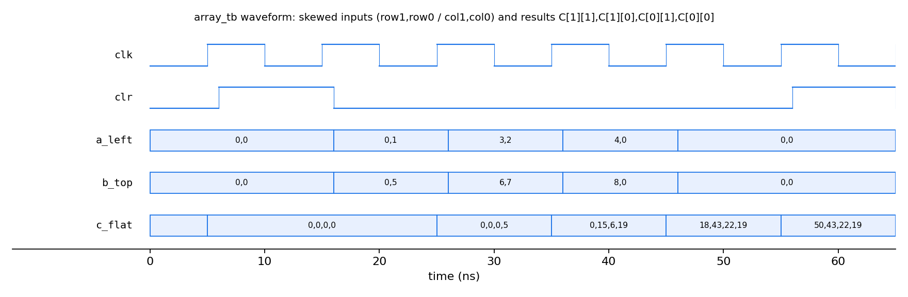

<div align="center">

# TPU-inspired systolic array accelerator

**A 4x4 output-stationary grid of int8 multiply-accumulate units in Verilog, checked bit for bit against NumPy and up to 21x faster than a single MAC**

[](https://github.com/Vetri-78640/TPU-Inspired-Systolic-Array-Accelerator/actions/workflows/tests.yml)


Modern Computer Architecture - Project 12 - Team PowerPuffBoys, Section A - Phase I

[Report (PDF)](report/main.pdf) - [Demo video](VIDEO_LINK)

[Overview](#overview) - [Architecture](#architecture) - [Results](#results) - [Verification](#verification) - [Quick start](#quick-start) - [Structure](#repository-structure) - [Team](#team)

</div>

---

## Overview

A single multiply-accumulate (MAC) unit multiplies an N x K matrix by a K x N matrix one product at a time, in N·N·K cycles. Accelerators such as Google's TPU use a systolic array instead: a grid of MACs where each operand is read once and then passed from neighbour to neighbour, so many products are computed in the same cycle. This project builds one in Verilog and asks one question: **how much faster is a 4x4 systolic array than a single MAC, and what does it cost in hardware?**

**Answer:** at 4x4x4 the array finishes in 12 cycles against 65 for a single MAC, a 5.42x speed-up. The gap grows with the problem size:

- 14.24x at K = 64 on the same 4x4 array, because the fill and drain time is spread over more work;
- 21.38x on an 8x8 array, which is the same Verilog with the parameter N set to 8.

In hardware, the 4x4 array maps to 16 DSP48E1 slices on Xilinx 7-series and runs at 53.48 MHz after place-and-route on a Lattice iCE40 HX8K.

| Stage | Scope | Status |
|---|---|---|
| Phase I | PE, array, skew, controller, sequential baseline, 106-case verification, synthesis, IEEE report | Done |
| Phase I | Demo video | In progress |
| Phase II | Streaming back-to-back matrices, pipelined MAC, tiling, Vivado timing, int8 layer demo | Planned ([roadmap](docs/roadmap.md)) |

## Architecture


Each processing element (PE) owns one output value. A values move right, B values move down, and every cycle each PE adds `a * b` to its own 32-bit accumulator. The outputs stay in place, so this is an output-stationary dataflow.

| Module | Role |
|---|---|
| `rtl/pe.v` | int8 x int8 multiply, int32 accumulate, passes `a` right and `b` down one cycle later |
| `rtl/systolic_array.v` | N x N grid of PEs built with generate loops; N is a parameter |
| `rtl/skew.v` | delays row i of A and column j of B by i and j cycles |
| `rtl/controller.v` | IDLE, CLEAR, RUN, DONE state machine: one-cycle clear, counted run, `done` held |
| `rtl/mm_accel.v` | top level: input buffers, feeders, two skew blocks and the array |
| `rtl/seq_mac.v` | single-MAC baseline with the same interface, for comparison |
| `rtl/fpga_top.v` | read-out wrapper that selects one 32-bit result, used for place-and-route |


Because of the skew, PE(i,j) always receives A[i][k] and B[k][j] in the same cycle. The results fill the grid as a diagonal wavefront, and the bottom-right PE finishes last.

| Design | Cycles for an N x K by K x N product |
|---|---|
| Systolic array, compute only | M + N + K - 2 |
| Systolic array, measured with clear and done | 2N + K |
| Sequential single MAC | N·N·K + 1 |

## Results

Cycle counts from simulation, on the same input vectors for both designs ([results/performance.csv](results/performance.csv)).

| N | K | Systolic cycles | Sequential cycles | Speed-up | PE utilization |
|---|---|---|---|---|---|
| 2 | 2 | 6 | 9 | 1.50x | 33.3% |
| 3 | 3 | 9 | 28 | 3.11x | 33.3% |
| 4 | 4 | 12 | 65 | 5.42x | 33.3% |
| 4 | 8 | 16 | 129 | 8.06x | 50.0% |
| 4 | 16 | 24 | 257 | 10.71x | 66.7% |
| 4 | 32 | 40 | 513 | 12.82x | 80.0% |
| 4 | 64 | 72 | 1025 | 14.24x | 88.9% |
| 8 | 8 | 24 | 513 | 21.38x | 33.3% |


Utilization is K / (2N + K). The array spends about 2N cycles filling and draining, so a short K leaves most PEs idle (33% at 4x4x4). Streaming matrices back to back, planned for Phase II, removes that gap.

| Target | Tool | N | Result |
|---|---|---|---|
| Xilinx 7-series | Yosys `synth_xilinx` | 4 | 16 DSP48E1, 75 LUTs, 16 RAM32M, 176 flip-flops |
| Lattice iCE40 HX8K | nextpnr-ice40, post-route | 2 | 61.39 MHz, 1559 logic cells (20%) |
| Lattice iCE40 HX8K | nextpnr-ice40, post-route | 4 | 53.48 MHz, 6811 logic cells (88%) |

No FPGA board was used. Hardware numbers come from synthesis and place-and-route ([results/](results/)).

## Verification

Every output of every test is compared with NumPy, bit for bit.

- `scripts/gen_vectors.py` writes 106 cases per size: 6 directed and 100 random (seed 7). The directed cases are identity, all zeros, all -128 (the largest product), alternating 127 and -128 signs, a single non-zero corner value and a fixed pattern.
- Unit testbenches cover the PE, the skew, the controller and a bare 2x2 array. Each one prints `PASSED` or `FAIL`.
- The full accelerator passes 106 of 106 cases at 2x2, 3x3, 4x4, 4x16 and 8x8.
- The sequential baseline runs on the same vectors through the same testbench.
- GitHub Actions runs `make test`, the baseline and the Python model on every push.



**Known limits.** The buffer address and cycle counter are 8 bits wide, so N·K ≤ 256 (K ≤ 64 for N = 4). Matrices larger than the array are not tiled, and only one matrix is processed at a time. These are the Phase II goals.

## Quick start

Requirements: Icarus Verilog 11+, Python 3.9+ with NumPy and Matplotlib. Yosys and nextpnr-ice40 are only needed for `make synth` and `make fmax`.

```bash
git clone https://github.com/Vetri-78640/TPU-Inspired-Systolic-Array-Accelerator.git
cd TPU-Inspired-Systolic-Array-Accelerator
make test
```

Expected result:

```
ALL PE TESTS PASSED
ALL SKEW TESTS PASSED: lane i delayed by i cycles
ALL CONTROLLER TESTS PASSED
ALL ARRAY TESTS PASSED
ALL 106 MATRIX TESTS PASSED
```

| Command | What it does |
|---|---|
| `make test` | all unit tests and the 106-case accelerator test |
| `make accel N=8 K=8` | accelerator test at another size |
| `make seq` | sequential baseline on the same vectors |
| `make model` | Python cycle model against NumPy |
| `make perf` | cycle sweep, writes `results/` |
| `make synth` | Yosys resource reports |
| `make fmax` | iCE40 place-and-route timing |
| `make wave` | plot the 2x2 array waveform |

Simulations write waveforms to `sim/*.vcd`, which open in GTKWave, Surfer or VaporView. The accelerator testbench writes one only when `+wave` is passed to `vvp`.

## Repository structure

```
rtl/       pe.v, systolic_array.v, skew.v, controller.v, mm_accel.v, seq_mac.v, fpga_top.v
tb/        pe_tb.v, skew_tb.v, controller_tb.v, array_tb.v, mm_accel_tb.v
scripts/   gen_vectors.py, os_model.py, perf.py, synth.sh, fmax.sh, plot_wave.py, diagrams.py
results/   performance.csv, speedup_vs_k.png, synth_*.txt, fmax_ice40.txt
docs/      architecture, design decisions, roadmap, diagrams
report/    IEEE report, LaTeX source and PDF
```

## Team

| Member | GitHub | Part |
|---|---|---|
| Vetriselvan R | [@Vetri-78640](https://github.com/Vetri-78640) | Array core: PE and systolic array |
| Hrishi Dongre | [@hrishidongre](https://github.com/hrishidongre) | Input timing and control: skew, controller, top level |
| Ishan Goyal | [@ishan-goyal-12](https://github.com/ishan-goyal-12) | Verification: test vectors and testbenches |
| Pampana Sree Adithya | [@adithyanst](https://github.com/adithyanst) | Baseline and performance: sequential MAC, sweeps, synthesis |
| Vedant Madne | [@vedant-valid](https://github.com/vedant-valid) | Report, diagrams and video |

B.Tech CS&AI, Newton School of Technology, Rishihood University.

## Documentation

- [Architecture specification](docs/architecture.md) - modules, ports, timing, limits
- [Design decisions](docs/design_decisions.md) - what we chose and why
- [Roadmap](docs/roadmap.md) - Phase I status and Phase II plan
- [Contributing](CONTRIBUTING.md) - ownership, rules and commit style
