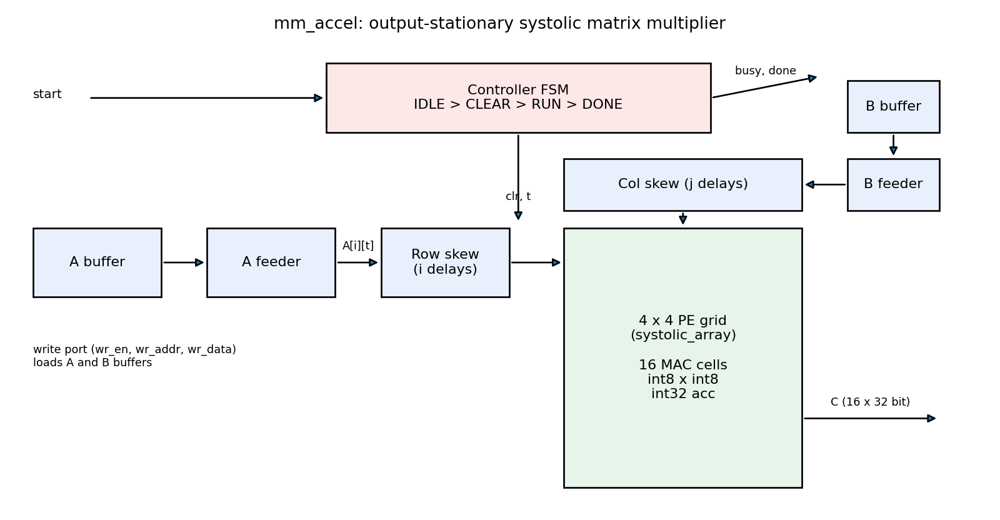
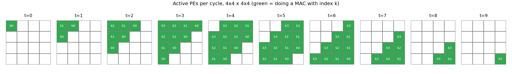
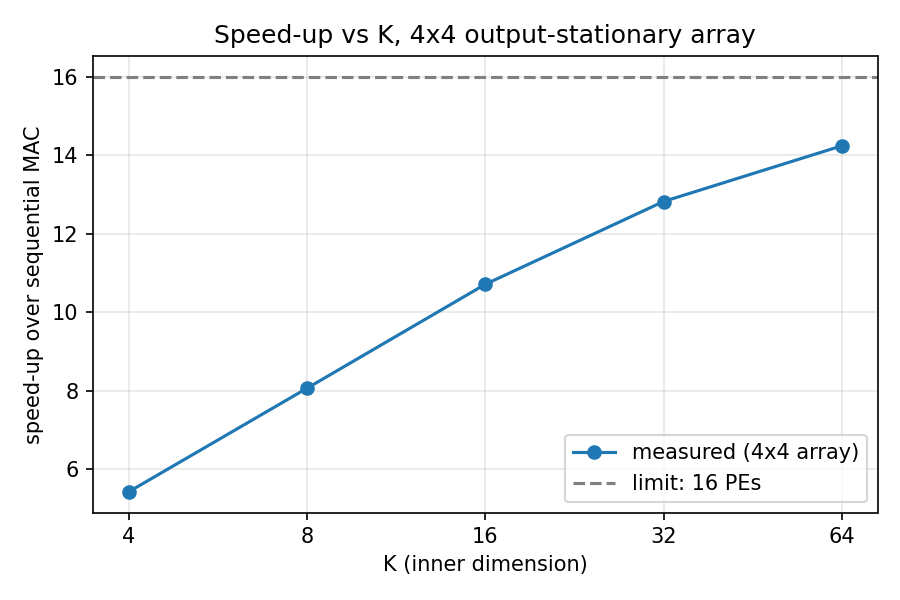

# TPU-Inspired Systolic Array Accelerator

A 4x4 output-stationary systolic array that multiplies signed 8-bit matrices, written in Verilog-2001 and verified against NumPy in simulation. Built for Project 12 (Systolic Array Matrix Multiplication Accelerator) of Modern Computer Architecture, B.Tech CS&AI, Section A.

- Report (Phase I, IEEE format): [report/main.pdf](report/main.pdf)
- Demo video: VIDEO_LINK

## Team PowerPuffBoys

| Member | GitHub | Part |
|---|---|---|
| Vetriselvan R | [@Vetri-78640](https://github.com/Vetri-78640) | Array core: PE and systolic array |
| Hrishi Dongre | [@hrishidongre](https://github.com/hrishidongre) | Input timing and control: skew, controller, top level |
| Ishan Goyal | [@ishan-goyal-12](https://github.com/ishan-goyal-12) | Verification: test vectors and testbenches |
| Pampana Sree Adithya | [@adithyanst](https://github.com/adithyanst) | Baseline and performance: sequential MAC, sweeps, synthesis |
| Vedant Madne | [@vedant-valid](https://github.com/vedant-valid) | Report, diagrams and video |

## How it works



- Each processing element (PE) multiplies an int8 `a` and `b`, adds the product to its own int32 accumulator, and passes `a` right and `b` down one cycle later.
- Row `i` of A and column `j` of B enter the grid `i` and `j` cycles late (skew), so PE(i,j) always multiplies the matching pair `A[i][k] * B[k][j]`.
- A 4-state controller (IDLE, CLEAR, RUN, DONE) clears the accumulators, streams the inputs and raises `done`.
- Compute time is `M + N + K - 2` cycles, against `M * N * K` for a single MAC unit.



## Results

All 106 test cases (6 directed + 100 random) pass for N x K = 2x2, 3x3, 4x4, 4x16 and 8x8.

| N | K | Systolic cycles | Sequential cycles | Speed-up |
|---|---|---|---|---|
| 4 | 4 | 12 | 65 | 5.42x |
| 8 | 8 | 24 | 513 | 21.38x |
| 4 | 16 | 24 | 257 | 10.71x |
| 4 | 64 | 72 | 1025 | 14.24x |

Full table: [results/performance.csv](results/performance.csv). Synthesis (Yosys, Xilinx 7-series): the 4x4 array uses 16 DSP48E1 slices, 75 LUTs and 176 flip-flops ([results/synth_n4.txt](results/synth_n4.txt)).



## Repository layout

```
rtl/       pe.v, systolic_array.v, skew.v, controller.v, mm_accel.v, seq_mac.v
tb/        pe_tb.v, skew_tb.v, array_tb.v, mm_accel_tb.v
scripts/   gen_vectors.py, os_model.py, perf.py, synth.sh, diagrams.py
results/   performance.csv, speedup_vs_k.png, synth_*.txt
docs/      diagrams
report/    IEEE report (LaTeX source and PDF)
```

## Running it

Requirements: Icarus Verilog 11+, Python 3.9+ with NumPy and Matplotlib, Yosys (only for `make synth`).

```bash
make test              # PE, skew, array and 106-case accelerator tests
make accel N=8 K=8     # accelerator at another size
make seq               # sequential baseline on the same vectors
make model             # Python cycle model vs NumPy
make perf              # cycle sweep, writes results/
make synth             # Yosys resource reports
```

Waveforms are written to `sim/*.vcd` (add `+wave` to `vvp` for the accelerator testbench) and can be opened in GTKWave or Surfer.
